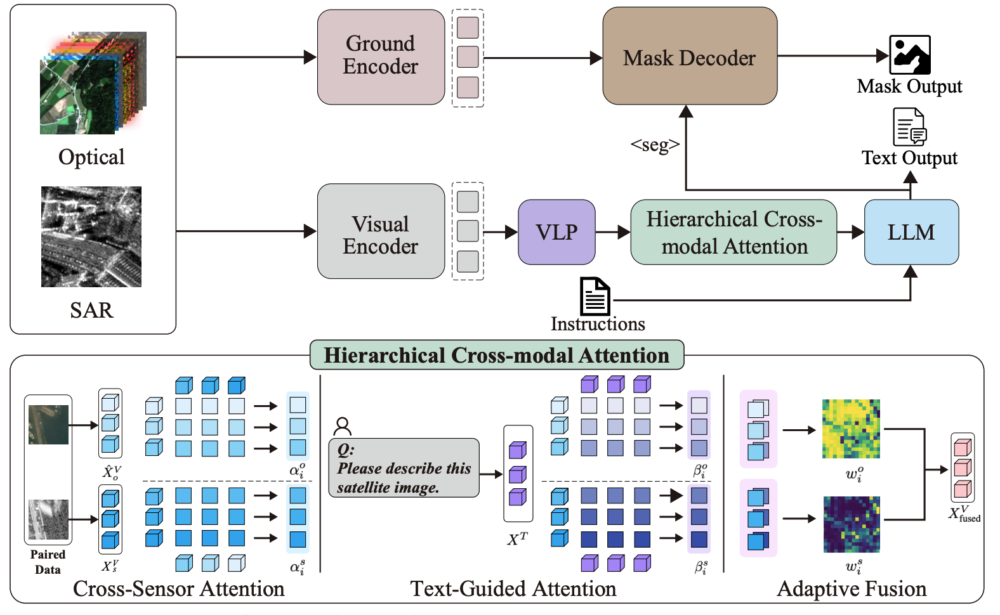
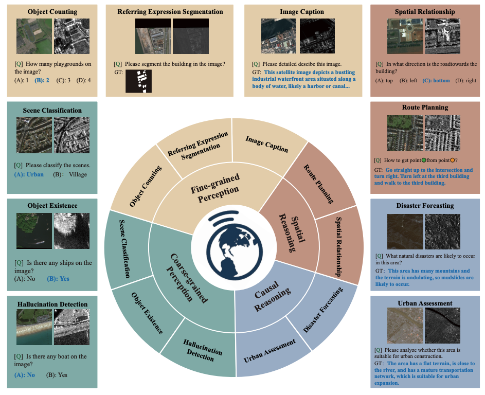

## EarthMind: Leveraging Cross-Sensor Data for Advanced Earth Observation Interpretation with a Unified Multimodal LLM
<p align="center">
    🌐 <a href="" target="_blank">Blog</a> | 📃 <a href="https://arxiv.org/abs/2506.01667" target="_blank">Paper</a> | 🤗 <a href="https://huggingface.co/sy1998/EarthMind-4B" target="_blank">Model</a> |  🤗 <a href="https://huggingface.co/datasets/sy1998/EarthMind-data" target="_blank">Training_Data</a> | 🤗 <a href="https://huggingface.co/datasets/sy1998/EarthMind-Bench" target="_blank">Benchmarks</a> |  🎥 <a href="" target="_blank">Demo</a>

</p>


#### [Yan Shu <sup>1</sup>](https://shuyansy.github.io/), [Bin Ren <sup>1,4,5</sup>](https://amazingren.github.io/), [Zhitong Xiong <sup>3</sup>](https://zhitong-xiong.github.io/), [Danda Pani Paudel <sup>5</sup>](https://people.ee.ethz.ch/~paudeld/), [Luc Van Gool <sup>5</sup>](https://scholar.google.com/citations?user=TwMib_QAAAAJ&hl=en), [Begüm Demir <sup>2</sup>](https://rsim.berlin/), [Nicu Sebe <sup>1</sup>](https://scholar.google.com/citations?user=stFCYOAAAAAJ&hl=en), and [Paolo Rota <sup>1</sup>](https://paolorota.eu/)

<sup>1</sup> University of Trento, Italy, <br>
<sup>2</sup> Technische Universität Berlin, Germany, <br>
<sup>3</sup> Technical University of Munich, Germany, <br>
<sup>4</sup> University of Pisa, Italy, <br>
<sup>5</sup> INSAIT, Sofia University “St. Kliment Ohridski”, Bulgaria<br>


<p align="center">
    
</p>


✨ **Highlights**:

(i) The first multi-granular and multi-sensor Earth Observation LMMs. EarthMind can handle Optical (RGB and MultiSpectral) and SAR image perception and reasoning.

(ii) EarthMind achieves strong performance on several downstream EO tasks, including but not limited to Scene classification, VQA, Captioning and segmentation tasks. 

(iii) Proposing EarthMind-Bench, the first multi-sensor EO benchmarks, including 10 subtasks, evaluating the perception and reasoning ability of LMMs.


## Model weights
Please download our pre-trained weights from the [link](https://huggingface.co/sy1998/EarthMind-Pretrain) and finetuned model weights from the [link](https://huggingface.co/sy1998/EarthMind-4B) (For single sensor scenarios) and [link](https://huggingface.co/sy1998/EarthMind4B_multi) (for multi sensor scenarios).

The IEEE GRSM version with GeoSync Attention (GeSA) is released as [EarthMind-4B-GeSA](https://huggingface.co/sy1998/EarthMind-4B-GeSA); see [GeoSync Attention (GeSA)](#geosync-attention-gesa) for inference, training and evaluation.
  
## Installation 
```bash
conda create -n vlm python=3.10
conda activate vlm
conda install pytorch==2.3.1 torchvision==0.18.1 pytorch-cuda=12.1 cuda -c pytorch  -c "nvidia/label/cuda-12.1.0" -c "nvidia/label/cuda-12.1.1"
pip install mmcv==2.1.0 -f https://download.openmmlab.com/mmcv/dist/cu121/torch2.3/index.html
pip install -r requirements.txt
```

## GeoSync Attention (GeSA)

The IEEE GRSM version of EarthMind fuses co-registered sensors with **GeoSync Attention (GeSA)**. Optical tokens (an RGB image, or Sentinel-2 bands grouped into pseudo-RGB frames), SAR tokens (the SAR image zero-padded to pseudo-RGB) and the instruction form one sequence. All visual tokens attend to each other bidirectionally while text stays causal (Eq. 3), and co-located optical and SAR tokens share their RoPE position ids (Eq. 4). GeSA adds no parameters.

Code: `projects/llava_sam2/hf/models/gesa_utils.py` (attention mask, position ids, sensor pre-processing), `projects/llava_sam2/models/internvl.py` (training) and `predict_forward_gesa` in `projects/llava_sam2/hf/models/modeling_earthmind_chat.py` (inference). Checkpoints whose config has no GeSA settings (EarthMind-4B, EarthMind4B_multi) keep the original code path.

**Weights:** [sy1998/EarthMind-4B-GeSA](https://huggingface.co/sy1998/EarthMind-4B-GeSA)

### Inference

```python
import torch
from PIL import Image
from transformers import AutoModel, AutoTokenizer

path = 'sy1998/EarthMind-4B-GeSA'
model = AutoModel.from_pretrained(path, torch_dtype=torch.bfloat16, trust_remote_code=True).eval().cuda()
tokenizer = AutoTokenizer.from_pretrained(path, trust_remote_code=True)

rgb = Image.open('data/pair_data/test/rgb/img/dfc2023_test_P_0456.png')
sar = Image.open('data/pair_data/test/sar/img/dfc2023_test_P_0456.png')

# optical + SAR; pass only optical= or only sar= for single-sensor input
out = model.predict_forward_gesa(optical=rgb, sar=sar, text='<image>Please describe the image.', tokenizer=tokenizer)
print(out['prediction'])

# referring segmentation: one mask per [SEG] token (SAM2 receives the SAR image when SAR is given)
out = model.predict_forward_gesa(optical=rgb, sar=sar, text='<image>Please segment the building in this image.',
                                 tokenizer=tokenizer)
masks = out['prediction_masks']  # list of (1, H, W) boolean arrays
```

`model.predict_forward(image=...)` uses the same GeSA path for single images. For multispectral input, pass the pseudo-RGB frames of `ms_folder_to_pseudo_frames(<folder with the Sentinel-2 band .tif files>)` from `projects.llava_sam2.hf.models.gesa_utils` as `optical=`.

### Training

Download [EarthMind-Pretrain](https://huggingface.co/sy1998/EarthMind-Pretrain) into `pretrained/` (`InternVL2_5-4B/`, `iter_112588.pth`, `sam2_hiera_large.pt`) and the [training data](#training-data) into `data/`, then run stage 2 with GeSA. The config follows Table IV of the paper (global batch 64, lr 4e-5, warm-up ratio 0.3, weight decay 0, one epoch; LoRA, projector and mask decoder are trained). It is set up for 4 GPUs (per-GPU batch 2 x `accumulative_counts` 8); with 8 GPUs set `accumulative_counts = 4`. The released checkpoint was trained on 4 H200 GPUs in about 22 hours.

```bash
bash tools/dist.sh train projects/llava_sam2/configs/gesa/earthmind_4b_stage2_gesa.py 4

export PYTHONPATH="./:$PYTHONPATH"
python projects/llava_sam2/hf/convert_to_hf.py projects/llava_sam2/configs/gesa/earthmind_4b_stage2_gesa.py \
    --pth-model $(cat work_dirs/earthmind_4b_stage2_gesa/last_checkpoint) --save-path your_model_path
```

The LLM runs with SDPA attention because FlashAttention-2 cannot take the GeSA mask. The conversion stores the GeSA settings in the HF config.

### Evaluation

Run the commands from the `EarthMind/` folder. The scripts in `projects/llava_sam2/evaluation/gesa/` process one shard per GPU (`--shard i --num_shards n`) and combine the shards with `--merge`; the examples below run a single shard.

```bash
export PYTHONPATH="./:$PYTHONPATH"
M=sy1998/EarthMind-4B-GeSA            # or a local HF folder
G=projects/llava_sam2/evaluation/gesa

# EOFuse-Bench (download EarthMind-Bench into data/EOFuse-Bench): multiple-choice tasks, referring
# segmentation and open-ended generation; --setting optical | sar | fused
python $G/eval_eofuse.py --model_path $M --setting fused --tasks mcq,seg,oe --out_dir results/eofuse
python $G/eval_eofuse.py --model_path $M --setting fused --tasks mcq,seg,oe --out_dir results/eofuse --merge

# VRSBench-VQA and UC-Merced
python $G/table2_image_eval.py --model_path $M --task vrsbench_vqa --out_dir results/table2
python $G/table2_image_eval.py --model_path $M --task vrsbench_vqa --out_dir results/table2 --merge
python $G/table2_image_eval.py --model_path $M --task ucm --out_dir results/table2
python $G/table2_image_eval.py --model_path $M --task ucm --out_dir results/table2 --merge

# GPT judge (gpt-4o, any OpenAI-compatible endpoint) for the EOFuse-Bench open-ended tasks (O-Avg)
# and VRSBench-VQA
python $G/gpt_judge/make_inputs.py --results results --out results/gpt_judge --run gesa:eofuse:table2:fused
export JUDGE_API_KEY=<your key>       # or OPENAI_API_KEY; --base_url for other endpoints
python results/gpt_judge/judge.py run --model gpt-4o    # -> results/gpt_judge/outputs/summary.json

# RRSIS-D and RefSegRS (released script)
torchrun --nproc_per_node=1 projects/llava_sam2/evaluation/refrs_eval.py --model_path $M --dataset rrsisd --split test --launcher pytorch
torchrun --nproc_per_node=1 projects/llava_sam2/evaluation/refrs_eval.py --model_path $M --dataset refsegrs --split test --launcher pytorch

# BigEarthNet-S2: 12 bands -> 4 pseudo-RGB frames (RGB | B01 B05 B06 | B07 B08 B8A | B09 B11 B12)
python $G/ms_bigearthnet_eval.py --model_path $M --grouping paper --out_dir results/bigearthnet
python $G/ms_bigearthnet_eval.py --out_dir results/bigearthnet --merge
```

`projects/llava_sam2/tests/test_gesa.py` contains unit tests for the attention mask and position ids (`python -m pytest -q projects/llava_sam2/tests/test_gesa.py`).

## Quick Start With HuggingFace

<details>
    <summary>Example Code (single modality infer)</summary>
    
```python
import argparse
import os

from PIL import Image
from transformers import AutoModelForCausalLM, AutoTokenizer

import cv2
try:
    from mmengine.visualization import Visualizer
except ImportError:
    Visualizer = None
    print("Warning: mmengine is not installed, visualization is disabled.")


def parse_args():
    parser = argparse.ArgumentParser(description='Video Reasoning Segmentation')
    parser.add_argument('--image_folder', default="demo_images", help='Path to image file')
    parser.add_argument('--model_path', default="/scqian/EarthMind-4B")
    parser.add_argument('--work-dir', default="result", help='The dir to save results.')
    parser.add_argument('--text', type=str, default="<image>Please segment the left chimney.")
    parser.add_argument('--select', type=int, default=-1)
    args = parser.parse_args()
    return args


def visualize(pred_mask, image_path, work_dir):
    visualizer = Visualizer()
    img = cv2.imread(image_path)
    visualizer.set_image(img)
    visualizer.draw_binary_masks(pred_mask, colors='g', alphas=0.4)
    visual_result = visualizer.get_image()

    output_path = os.path.join(work_dir, os.path.basename(image_path))
    cv2.imwrite(output_path, visual_result)

if __name__ == "__main__":
    cfg = parse_args()
    model_path = cfg.model_path
    model = AutoModelForCausalLM.from_pretrained(
        model_path,
        torch_dtype="auto",
        device_map="cuda:0",
        trust_remote_code=True
    )

    tokenizer = AutoTokenizer.from_pretrained(
        model_path,
        trust_remote_code=True
    )

    image_files = []
    image_paths = []
    image_extensions = {".jpg", ".jpeg", ".png", ".bmp", ".gif", ".tiff"}
    for filename in sorted(list(os.listdir(cfg.image_folder))):
        if os.path.splitext(filename)[1].lower() in image_extensions:
            image_files.append(filename)
            image_paths.append(os.path.join(cfg.image_folder, filename))

    vid_frames = []
    for img_path in image_paths:
        img = Image.open(img_path).convert('RGB')
        vid_frames.append(img)


    if cfg.select > 0:
        img_frame = vid_frames[cfg.select - 1]

        print(f"Selected frame {cfg.select}")
        print(f"The input is:\n{cfg.text}")
        result = model.predict_forward(
            image=img_frame,
            text=cfg.text,
            tokenizer=tokenizer,
        )
    else:
        print("##########",vid_frames[0])
        print(f"The input is:\n{cfg.text}")
        result = model.predict_forward(
            video=vid_frames,
            text=cfg.text,
            tokenizer=tokenizer,
        )

    prediction = result['prediction']
    print(f"The output is:\n{prediction}")

    if '[SEG]' in prediction and Visualizer is not None:
        _seg_idx = 0
        pred_masks = result['prediction_masks'][_seg_idx]
        for frame_idx in range(len(vid_frames)):
            pred_mask = pred_masks[frame_idx]
            if cfg.work_dir:
                os.makedirs(cfg.work_dir, exist_ok=True)
                visualize(pred_mask, image_paths[frame_idx], cfg.work_dir)
            else:
                os.makedirs('./temp_visualize_results', exist_ok=True)
                visualize(pred_mask, image_paths[frame_idx], './temp_visualize_results')
    else:
        pass
```
</details>


<details>
    <summary>Example Code (multi modality infer)</summary>
    
```python
import argparse
import os
import torch
from PIL import Image
from transformers import AutoModelForCausalLM, AutoTokenizer

import cv2
try:
    from mmengine.visualization import Visualizer
except ImportError:
    Visualizer = None
    print("Warning: mmengine is not installed, visualization is disabled.")


def parse_args():
    parser = argparse.ArgumentParser(description='Video Reasoning Segmentation')
    parser.add_argument('--image_path', default="data/pair_data/test/rgb/img/dfc2023_test_P_0456.png", help='Path to image file')
    parser.add_argument('--sar_image_path', default="data/pair_data/test/sar/img/dfc2023_test_P_0456.png", help='Path to image file')
    parser.add_argument('--model_path', default="/data/Earthmind_proj/final_retrain_multi")
    parser.add_argument('--work-dir', default="result", help='The dir to save results.')
    parser.add_argument('--text', type=str, default="<image>Please describe the image.")
    parser.add_argument('--select', type=int, default=-1)
    args = parser.parse_args()
    return args


def visualize(pred_mask, image_path, work_dir):
    visualizer = Visualizer()
    img = cv2.imread(image_path)
    visualizer.set_image(img)
    visualizer.draw_binary_masks(pred_mask, colors='g', alphas=0.4)
    visual_result = visualizer.get_image()

    output_path = os.path.join(work_dir, os.path.basename(image_path))
    cv2.imwrite(output_path, visual_result)

if __name__ == "__main__":
    cfg = parse_args()
    model_path = cfg.model_path
    model = AutoModelForCausalLM.from_pretrained(
        model_path,
        torch_dtype="auto",
        device_map="cuda:0",
        trust_remote_code=True
    )


    tokenizer = AutoTokenizer.from_pretrained(
        model_path,
        trust_remote_code=True
    )


    img_path=cfg.image_path
    image_paths=[img_path]
 
    img = Image.open(img_path).convert('RGB')


    sar_img_path=cfg.sar_image_path
    sar_img = Image.open(sar_img_path).convert('RGB')


    print(f"Selected frame {cfg.select}")
    print(f"The input is:\n{cfg.text}")
    result = model.predict_forward_multi(
        image=sar_img,
        rgb_image=img,
        text=cfg.text,
        tokenizer=tokenizer,
    )
  
    prediction = result['prediction']
    print(f"The output is:\n{prediction}")

    if '[SEG]' in prediction and Visualizer is not None:
        _seg_idx = 0
        pred_masks = result['prediction_masks'][_seg_idx]
        for frame_idx in range(len(vid_frames)):
            pred_mask = pred_masks[frame_idx]
            if cfg.work_dir:
                os.makedirs(cfg.work_dir, exist_ok=True)
                visualize(pred_mask, image_paths[frame_idx], cfg.work_dir)
            else:
                os.makedirs('./temp_visualize_results', exist_ok=True)
                visualize(pred_mask, image_paths[frame_idx], './temp_visualize_results')
    else:
        pass
```
</details>


## Training
Please download the training data and pretrained weights into the data folder and pretrained folder, and then run the following code. We recommend using 8 A100 GPUs for training. 
```bash
 bash tools/dist.sh train projects/llava_sam2/configs/earthmind_4b_sft.py 8
```

Based on the trained weight on single-modality RS data, continue training in multi-sensor data.
```bash
 bash tools/dist.sh train projects/llava_sam2/configs/earthmind_4b_multi.py 8
```

After training, please run the following script to convert models to hf format:
```bash
export PYTHONPATH="./:$PYTHONPATH"
python projects/llava_sam2/hf/convert_to_hf.py projects/llava_sam2/configs/earthmind_4b_sft.py --pth-model work_dirs/earthmind_4b_sft/iter_252380.pth --save-path your_model_path
```


## Evaluation
For image-level evaluation (scene classification, VQA and captioning), you can run 
```bash
bash scripts_eval/image_task_eval.sh
```
For region-level evaluation (region captioning), you can run 
```bash
bash region_task.sh
```
For pixel-level evaluation (segmentation), you can run 
```bash
bash pixel_task_eval.sh
```
For multispectral data evaluation, you can run 
```bash
bash multi_spectrum.sh
```
For EarthMind-Bench evaluation, you can run 
```bash
bash earthmind-bench.sh
```


## Training Data
We have released our training data in [link](https://huggingface.co/datasets/sy1998/EarthMind-data) and [link](https://huggingface.co/datasets/sy1998/Multisensor_RS_Data/tree/main).

## EarthMind-Bench

<p align="center">
    
</p>

✨ **Highlights**:

(i) EarthMind-Bench supports multi-sensor (optical and SAR) joint evaluation. 

(ii) EarthMind evaluates the perception and reasoning ability along with the multi-level abilities of LMMs.

The data of EarthMind-Bench can be downloaded in [link](https://huggingface.co/datasets/sy1998/EarthMind-Bench).
The evaluation methods can be seen in [MCQ](projects/llava_sam2/evaluation/infer_earthmindbench_mcq.py) and [OE](projects/llava_sam2/evaluation/infer_earthmindbench_oe.py).


## Citation
If you find this repository useful, please consider giving a star :star: and citation

```
@article{shu2025earthmind,
  title={EarthMind: Towards Multi-Granular and Multi-Sensor Earth Observation with Large Multimodal Models},
  author={Shu, Yan and Ren, Bin and Xiong, Zhitong and Paudel, Danda Pani and Van Gool, Luc and Demir, Begum and Sebe, Nicu and Rota, Paolo},
  journal={arXiv preprint arXiv:2506.01667},
  year={2025}
}
```

## Acknowledgement
- Sa2VA and GlaMM: the codebase we built upon. 

## License
This project utilizes certain datasets and checkpoints that are subject to their respective original licenses. Users must comply with all terms and conditions of these original licenses.
The content of this project itself is licensed under the [Apache license 2.0](./LICENSE).


