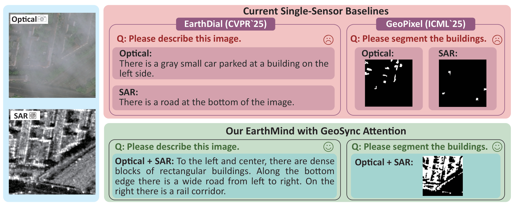
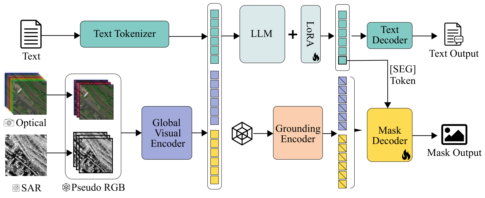
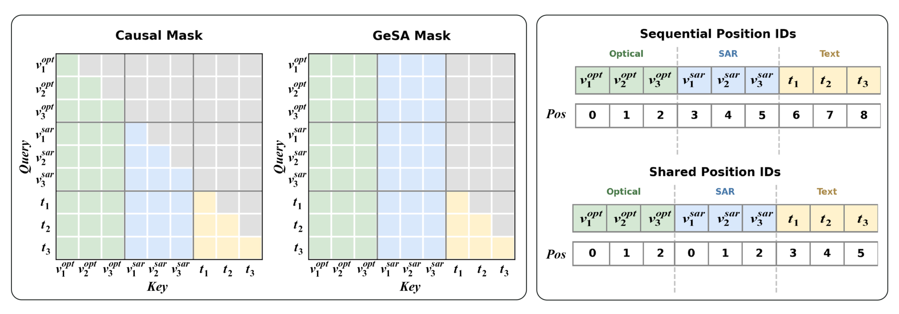
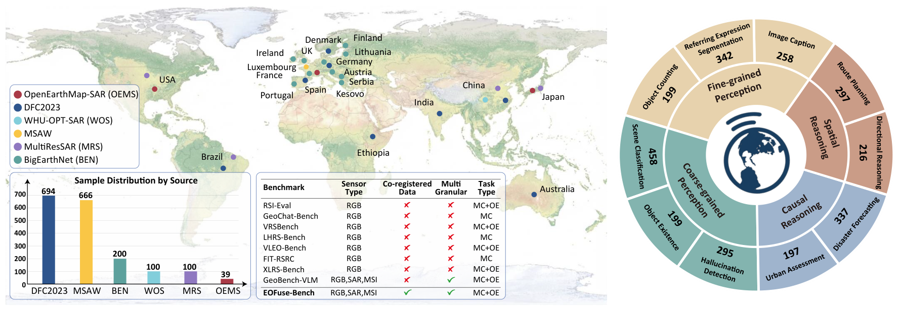
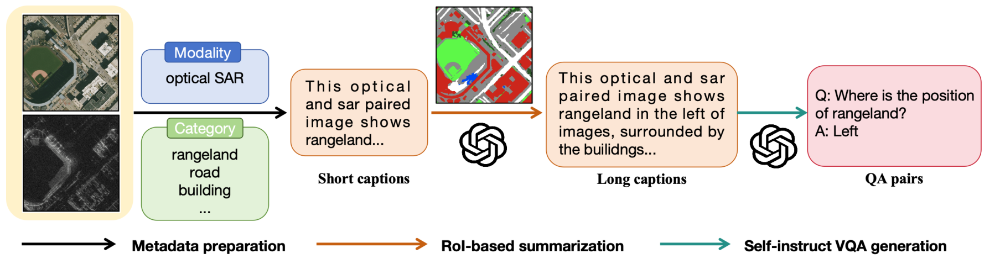
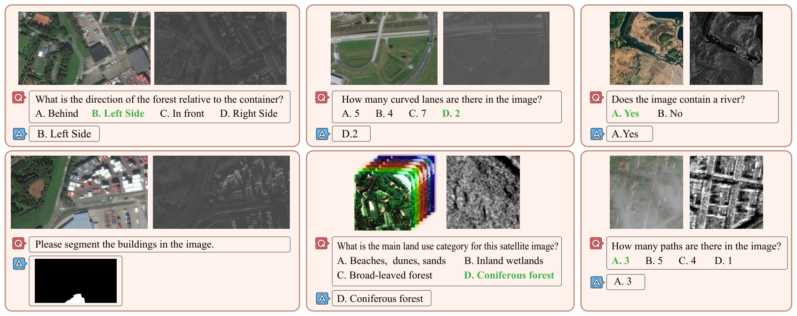

## EarthMind: Leveraging Cross-Sensor Data for Advanced Earth Observation Interpretation with a Unified Multimodal LLM

<p align="center">
    <b>IEEE Geoscience and Remote Sensing Magazine (GRSM)</b>
</p>

<p align="center">
    📃 <a href="https://arxiv.org/abs/2506.01667" target="_blank">Paper</a> | 🤗 <a href="https://huggingface.co/sy1998/EarthMind-4B-GeSA" target="_blank">Model</a> | 🤗 <a href="https://huggingface.co/datasets/sy1998/EarthMind-Bench" target="_blank">EOFuse-Bench</a> | 🤗 <a href="https://huggingface.co/datasets/sy1998/EarthMind-data" target="_blank">Training Data</a> | 🤗 <a href="https://huggingface.co/datasets/sy1998/Multisensor_RS_Data" target="_blank">FusionEO</a>
</p>

#### [Yan Shu <sup>1</sup>](https://shuyansy.github.io/), [Bin Ren <sup>1,4,*</sup>](https://amazingren.github.io/), [Zhitong Xiong <sup>3</sup>](https://zhitong-xiong.github.io/), [Danda Pani Paudel <sup>5</sup>](https://people.ee.ethz.ch/~paudeld/), [Luc Van Gool <sup>5</sup>](https://scholar.google.com/citations?user=TwMib_QAAAAJ&hl=en), [Begüm Demir <sup>2</sup>](https://rsim.berlin/), [Nicu Sebe <sup>1</sup>](https://scholar.google.com/citations?user=stFCYOAAAAAJ&hl=en), and [Paolo Rota <sup>1</sup>](https://paolorota.eu/)

<sup>1</sup> University of Trento, Italy, <br>
<sup>2</sup> BIFOLD and Technische Universität Berlin, Germany, <br>
<sup>3</sup> Technical University of Munich, Germany, <br>
<sup>4</sup> École Polytechnique Fédérale de Lausanne (EPFL), Switzerland, <br>
<sup>5</sup> INSAIT, Sofia University “St. Kliment Ohridski”, Bulgaria <br>
<sup>*</sup> Corresponding author

<p align="center">
    
</p>
<p align="center">
    <i>Single-sensor models (EarthDial, GeoPixel) fail on this hazy scene. EarthMind with GeoSync Attention combines the co-registered optical and SAR images.</i>
</p>


✨ **Highlights**:

(i) **EOFuse-Bench**, a benchmark for cross-sensor Earth Observation (EO) understanding: 2,087 strictly co-registered optical–SAR pairs (RGB and multispectral optical) and 10 subtasks, from image-level perception and reasoning to pixel-level grounding. Every question can be asked with optical input, SAR input or both, so the contribution of the second sensor can be measured directly.

(ii) **EarthMind**, a unified baseline for single- and cross-sensor EO understanding: image-level reasoning through the LLM and pixel-level grounding through a mask decoder. With it we identify **Modality Attention Bias**: when optical and SAR tokens are simply concatenated, the LLM attends mostly to the optical tokens, and the SAR information is not used.

(iii) **GeoSync Attention (GeSA)**, a parameter-free mechanism that lets all co-registered visual tokens attend to each other and gives co-located optical and SAR tokens shared position ids. GeSA makes EarthMind sensor-adaptive, achieving state-of-the-art results on EOFuse-Bench while remaining competitive on single-sensor EO benchmarks.

<p align="center">
    
</p>
<p align="center">
    <i>EarthMind. Optical (RGB or multispectral) and SAR images become pseudo-RGB frames for the visual encoder; the LLM (with LoRA) produces text, and its [SEG] token drives the mask decoder.</i>
</p>


## Model weights

| Model | Description |
|---|---|
| [EarthMind-4B-GeSA](https://huggingface.co/sy1998/EarthMind-4B-GeSA) | GRSM version with GeoSync Attention: optical, SAR, multispectral and cross-sensor input |
| [EarthMind-Pretrain](https://huggingface.co/sy1998/EarthMind-Pretrain) | stage-1 weights (`InternVL2_5-4B/`, `iter_112588.pth`, `sam2_hiera_large.pt`), the starting point for training |
| [EarthMind-4B](https://huggingface.co/sy1998/EarthMind-4B), [EarthMind4B_multi](https://huggingface.co/sy1998/EarthMind4B_multi) | earlier release: single-sensor model and multi-sensor model with weighted token fusion, see [Earlier release](#earlier-release-earthmind-4b-and-earthmind4b_multi) |

## Installation
```bash
conda create -n vlm python=3.10
conda activate vlm
conda install pytorch==2.3.1 torchvision==0.18.1 pytorch-cuda=12.1 cuda -c pytorch  -c "nvidia/label/cuda-12.1.0" -c "nvidia/label/cuda-12.1.1"
pip install mmcv==2.1.0 -f https://download.openmmlab.com/mmcv/dist/cu121/torch2.3/index.html
pip install -r requirements.txt
```

## GeoSync Attention (GeSA)

<p align="center">
    
</p>
<p align="center">
    <i>Left: unlike the causal mask, the GeSA mask lets all optical and SAR tokens attend to each other while text stays auto-regressive. Right: co-located tokens share their position ids.</i>
</p>

When optical and SAR tokens are concatenated, two properties of a decoder-only LLM work against fusion: the causal mask lets optical tokens attend only to earlier tokens, so they never see the SAR tokens that follow, and sequential position ids place co-located optical and SAR patches far apart. GeSA changes both. All visual tokens attend to each other bidirectionally while text stays causal (Eq. 3), and co-located optical and SAR tokens share their RoPE position ids (Eq. 4), so their relative distance is zero. Optical tokens come from an RGB image or from Sentinel-2 bands grouped into pseudo-RGB frames; the SAR image is zero-padded to pseudo-RGB. GeSA adds no parameters.

Code: `projects/llava_sam2/hf/models/gesa_utils.py` (attention mask, position ids, sensor pre-processing), `projects/llava_sam2/models/internvl.py` (training) and `predict_forward_gesa` in `projects/llava_sam2/hf/models/modeling_earthmind_chat.py` (inference). Checkpoints whose config has no GeSA settings (EarthMind-4B, EarthMind4B_multi) keep the original code path.

**Weights:** [sy1998/EarthMind-4B-GeSA](https://huggingface.co/sy1998/EarthMind-4B-GeSA)

### Inference

```python
import torch
from PIL import Image
from transformers import AutoModel, AutoTokenizer

path = 'sy1998/EarthMind-4B-GeSA'
model = AutoModel.from_pretrained(path, torch_dtype=torch.bfloat16, trust_remote_code=True).eval().cuda()
tokenizer = AutoTokenizer.from_pretrained(path, trust_remote_code=True)

rgb = Image.open('data/pair_data/test/rgb/img/dfc2023_test_P_0456.png')
sar = Image.open('data/pair_data/test/sar/img/dfc2023_test_P_0456.png')

# optical + SAR; pass only optical= or only sar= for single-sensor input
out = model.predict_forward_gesa(optical=rgb, sar=sar, text='<image>Please describe the image.', tokenizer=tokenizer)
print(out['prediction'])

# referring segmentation: one mask per [SEG] token (SAM2 receives the SAR image when SAR is given)
out = model.predict_forward_gesa(optical=rgb, sar=sar, text='<image>Please segment the building in this image.',
                                 tokenizer=tokenizer)
masks = out['prediction_masks']  # list of (1, H, W) boolean arrays
```

`model.predict_forward(image=...)` uses the same GeSA path for single images. For multispectral input, pass the pseudo-RGB frames of `ms_folder_to_pseudo_frames(<folder with the Sentinel-2 band .tif files>)` from `projects.llava_sam2.hf.models.gesa_utils` as `optical=`.

### Training

Download [EarthMind-Pretrain](https://huggingface.co/sy1998/EarthMind-Pretrain) into `pretrained/` (`InternVL2_5-4B/`, `iter_112588.pth`, `sam2_hiera_large.pt`) and the [training data](#training-data) into `data/`, then run stage 2 with GeSA. The config follows Table IV of the paper (global batch 64, lr 4e-5, warm-up ratio 0.3, weight decay 0, one epoch; LoRA, projector and mask decoder are trained). It is set up for 4 GPUs (per-GPU batch 2 x `accumulative_counts` 8); with 8 GPUs set `accumulative_counts = 4`. The released checkpoint was trained on 4 H200 GPUs in about 22 hours.

```bash
bash tools/dist.sh train projects/llava_sam2/configs/gesa/earthmind_4b_stage2_gesa.py 4

export PYTHONPATH="./:$PYTHONPATH"
python projects/llava_sam2/hf/convert_to_hf.py projects/llava_sam2/configs/gesa/earthmind_4b_stage2_gesa.py \
    --pth-model $(cat work_dirs/earthmind_4b_stage2_gesa/last_checkpoint) --save-path your_model_path
```

The LLM runs with SDPA attention because FlashAttention-2 cannot take the GeSA mask. The conversion stores the GeSA settings in the HF config.

### Evaluation

Run the commands from the `EarthMind/` folder. The scripts in `projects/llava_sam2/evaluation/gesa/` process one shard per GPU (`--shard i --num_shards n`) and combine the shards with `--merge`; the examples below run a single shard.

```bash
export PYTHONPATH="./:$PYTHONPATH"
M=sy1998/EarthMind-4B-GeSA            # or a local HF folder
G=projects/llava_sam2/evaluation/gesa

# EOFuse-Bench (download EarthMind-Bench into data/EOFuse-Bench): multiple-choice tasks, referring
# segmentation and open-ended generation; --setting optical | sar | fused
python $G/eval_eofuse.py --model_path $M --setting fused --tasks mcq,seg,oe --out_dir results/eofuse
python $G/eval_eofuse.py --model_path $M --setting fused --tasks mcq,seg,oe --out_dir results/eofuse --merge

# VRSBench-VQA and UC-Merced
python $G/table2_image_eval.py --model_path $M --task vrsbench_vqa --out_dir results/table2
python $G/table2_image_eval.py --model_path $M --task vrsbench_vqa --out_dir results/table2 --merge
python $G/table2_image_eval.py --model_path $M --task ucm --out_dir results/table2
python $G/table2_image_eval.py --model_path $M --task ucm --out_dir results/table2 --merge

# GPT judge (gpt-4o, any OpenAI-compatible endpoint) for the EOFuse-Bench open-ended tasks (O-Avg)
# and VRSBench-VQA
python $G/gpt_judge/make_inputs.py --results results --out results/gpt_judge --run gesa:eofuse:table2:fused
export JUDGE_API_KEY=<your key>       # or OPENAI_API_KEY; --base_url for other endpoints
python results/gpt_judge/judge.py run --model gpt-4o    # -> results/gpt_judge/outputs/summary.json

# RRSIS-D and RefSegRS (released script)
torchrun --nproc_per_node=1 projects/llava_sam2/evaluation/refrs_eval.py --model_path $M --dataset rrsisd --split test --launcher pytorch
torchrun --nproc_per_node=1 projects/llava_sam2/evaluation/refrs_eval.py --model_path $M --dataset refsegrs --split test --launcher pytorch

# BigEarthNet-S2: 12 bands -> 4 pseudo-RGB frames (RGB | B01 B05 B06 | B07 B08 B8A | B09 B11 B12)
python $G/ms_bigearthnet_eval.py --model_path $M --grouping paper --out_dir results/bigearthnet
python $G/ms_bigearthnet_eval.py --out_dir results/bigearthnet --merge
```

`projects/llava_sam2/tests/test_gesa.py` contains unit tests for the attention mask and position ids (`python -m pytest -q projects/llava_sam2/tests/test_gesa.py`).

## EOFuse-Bench

<p align="center">
    
</p>

EOFuse-Bench evaluates how well LMMs use co-registered sensors. It contains 2,087 strictly co-registered optical–SAR pairs covering cities on five continents at sub-meter to medium resolution. The RGB pairs come from OpenEarthMap-SAR, DFC2023 Track 2, WHU-OPT-SAR, MSAW and MultiResSAR, and the 12-band multispectral pairs from BigEarthNet-MM.

- **10 subtasks at several granularities.** Coarse-grained perception: scene classification, object existence, hallucination detection. Fine-grained perception: object counting, image captioning, referring expression segmentation. Spatial reasoning: route planning, directional reasoning. Causal reasoning: disaster forecasting, urban assessment.
- **Multiple-choice and open-ended questions.** Open-ended answers are scored by a GPT judge.
- **Single- and cross-sensor protocols.** The same model is evaluated with optical input, SAR input or both.

The data can be downloaded from [sy1998/EarthMind-Bench](https://huggingface.co/datasets/sy1998/EarthMind-Bench) (put it in `data/EOFuse-Bench`). EarthMind-4B-GeSA is evaluated with `eval_eofuse.py` (see [Evaluation](#evaluation)); the scripts for the earlier checkpoints are [MCQ](projects/llava_sam2/evaluation/infer_earthmindbench_mcq.py) and [OE](projects/llava_sam2/evaluation/infer_earthmindbench_oe.py).

## Training Data

<p align="center">
    
</p>
<p align="center">
    <i>FusionEO curation: metadata preparation, RoI-based summarization and self-instruct VQA generation with GPT-4o.</i>
</p>

EarthMind is trained in two stages. Stage 1 uses 1.7M general image–text samples (LLaVA-665K, referring expressions, grounded conversations and Osprey region descriptions). Stage 2 adapts the model to EO with public single-sensor data (EarthGPT, VRSBench, DIOR-RSVG, RRSIS-D, RefSegRS), multispectral data (BigEarthNet, So2Sat-LCZ42) and **FusionEO**, 30K optical–SAR paired dialogues. FusionEO is generated from the training splits of BigEarthNet-MM, OpenEarthMap-SAR, DFC2023 Track 2, WHU-OPT-SAR, MSAW and MultiResSAR, so it does not overlap with EOFuse-Bench.

The single-sensor and multispectral data are in [EarthMind-data](https://huggingface.co/datasets/sy1998/EarthMind-data); FusionEO (`pair_data.zip`) is in [Multisensor_RS_Data](https://huggingface.co/datasets/sy1998/Multisensor_RS_Data).

## Qualitative Results

<p align="center">
    
</p>

## Earlier release: EarthMind-4B and EarthMind4B_multi

The first release has a single-sensor model ([EarthMind-4B](https://huggingface.co/sy1998/EarthMind-4B)) and a multi-sensor model that fuses optical and SAR tokens by weighted averaging ([EarthMind4B_multi](https://huggingface.co/sy1998/EarthMind4B_multi)). The instructions below apply to these two checkpoints.

### Quick start (earlier checkpoints)

<details>
    <summary>Example Code (single modality infer)</summary>
    
```python
import argparse
import os

from PIL import Image
from transformers import AutoModelForCausalLM, AutoTokenizer

import cv2
try:
    from mmengine.visualization import Visualizer
except ImportError:
    Visualizer = None
    print("Warning: mmengine is not installed, visualization is disabled.")


def parse_args():
    parser = argparse.ArgumentParser(description='Video Reasoning Segmentation')
    parser.add_argument('--image_folder', default="demo_images", help='Path to image file')
    parser.add_argument('--model_path', default="/scqian/EarthMind-4B")
    parser.add_argument('--work-dir', default="result", help='The dir to save results.')
    parser.add_argument('--text', type=str, default="<image>Please segment the left chimney.")
    parser.add_argument('--select', type=int, default=-1)
    args = parser.parse_args()
    return args


def visualize(pred_mask, image_path, work_dir):
    visualizer = Visualizer()
    img = cv2.imread(image_path)
    visualizer.set_image(img)
    visualizer.draw_binary_masks(pred_mask, colors='g', alphas=0.4)
    visual_result = visualizer.get_image()

    output_path = os.path.join(work_dir, os.path.basename(image_path))
    cv2.imwrite(output_path, visual_result)

if __name__ == "__main__":
    cfg = parse_args()
    model_path = cfg.model_path
    model = AutoModelForCausalLM.from_pretrained(
        model_path,
        torch_dtype="auto",
        device_map="cuda:0",
        trust_remote_code=True
    )

    tokenizer = AutoTokenizer.from_pretrained(
        model_path,
        trust_remote_code=True
    )

    image_files = []
    image_paths = []
    image_extensions = {".jpg", ".jpeg", ".png", ".bmp", ".gif", ".tiff"}
    for filename in sorted(list(os.listdir(cfg.image_folder))):
        if os.path.splitext(filename)[1].lower() in image_extensions:
            image_files.append(filename)
            image_paths.append(os.path.join(cfg.image_folder, filename))

    vid_frames = []
    for img_path in image_paths:
        img = Image.open(img_path).convert('RGB')
        vid_frames.append(img)


    if cfg.select > 0:
        img_frame = vid_frames[cfg.select - 1]

        print(f"Selected frame {cfg.select}")
        print(f"The input is:\n{cfg.text}")
        result = model.predict_forward(
            image=img_frame,
            text=cfg.text,
            tokenizer=tokenizer,
        )
    else:
        print("##########",vid_frames[0])
        print(f"The input is:\n{cfg.text}")
        result = model.predict_forward(
            video=vid_frames,
            text=cfg.text,
            tokenizer=tokenizer,
        )

    prediction = result['prediction']
    print(f"The output is:\n{prediction}")

    if '[SEG]' in prediction and Visualizer is not None:
        _seg_idx = 0
        pred_masks = result['prediction_masks'][_seg_idx]
        for frame_idx in range(len(vid_frames)):
            pred_mask = pred_masks[frame_idx]
            if cfg.work_dir:
                os.makedirs(cfg.work_dir, exist_ok=True)
                visualize(pred_mask, image_paths[frame_idx], cfg.work_dir)
            else:
                os.makedirs('./temp_visualize_results', exist_ok=True)
                visualize(pred_mask, image_paths[frame_idx], './temp_visualize_results')
    else:
        pass
```
</details>


<details>
    <summary>Example Code (multi modality infer)</summary>
    
```python
import argparse
import os
import torch
from PIL import Image
from transformers import AutoModelForCausalLM, AutoTokenizer

import cv2
try:
    from mmengine.visualization import Visualizer
except ImportError:
    Visualizer = None
    print("Warning: mmengine is not installed, visualization is disabled.")


def parse_args():
    parser = argparse.ArgumentParser(description='Video Reasoning Segmentation')
    parser.add_argument('--image_path', default="data/pair_data/test/rgb/img/dfc2023_test_P_0456.png", help='Path to image file')
    parser.add_argument('--sar_image_path', default="data/pair_data/test/sar/img/dfc2023_test_P_0456.png", help='Path to image file')
    parser.add_argument('--model_path', default="/data/Earthmind_proj/final_retrain_multi")
    parser.add_argument('--work-dir', default="result", help='The dir to save results.')
    parser.add_argument('--text', type=str, default="<image>Please describe the image.")
    parser.add_argument('--select', type=int, default=-1)
    args = parser.parse_args()
    return args


def visualize(pred_mask, image_path, work_dir):
    visualizer = Visualizer()
    img = cv2.imread(image_path)
    visualizer.set_image(img)
    visualizer.draw_binary_masks(pred_mask, colors='g', alphas=0.4)
    visual_result = visualizer.get_image()

    output_path = os.path.join(work_dir, os.path.basename(image_path))
    cv2.imwrite(output_path, visual_result)

if __name__ == "__main__":
    cfg = parse_args()
    model_path = cfg.model_path
    model = AutoModelForCausalLM.from_pretrained(
        model_path,
        torch_dtype="auto",
        device_map="cuda:0",
        trust_remote_code=True
    )


    tokenizer = AutoTokenizer.from_pretrained(
        model_path,
        trust_remote_code=True
    )


    img_path=cfg.image_path
    image_paths=[img_path]
 
    img = Image.open(img_path).convert('RGB')


    sar_img_path=cfg.sar_image_path
    sar_img = Image.open(sar_img_path).convert('RGB')


    print(f"Selected frame {cfg.select}")
    print(f"The input is:\n{cfg.text}")
    result = model.predict_forward_multi(
        image=sar_img,
        rgb_image=img,
        text=cfg.text,
        tokenizer=tokenizer,
    )
  
    prediction = result['prediction']
    print(f"The output is:\n{prediction}")

    if '[SEG]' in prediction and Visualizer is not None:
        _seg_idx = 0
        pred_masks = result['prediction_masks'][_seg_idx]
        for frame_idx in range(len(vid_frames)):
            pred_mask = pred_masks[frame_idx]
            if cfg.work_dir:
                os.makedirs(cfg.work_dir, exist_ok=True)
                visualize(pred_mask, image_paths[frame_idx], cfg.work_dir)
            else:
                os.makedirs('./temp_visualize_results', exist_ok=True)
                visualize(pred_mask, image_paths[frame_idx], './temp_visualize_results')
    else:
        pass
```
</details>

### Training (earlier checkpoints)
Please download the training data and pretrained weights into the data folder and pretrained folder, and then run the following code. We recommend using 8 A100 GPUs for training. 
```bash
 bash tools/dist.sh train projects/llava_sam2/configs/earthmind_4b_sft.py 8
```

Based on the trained weight on single-modality RS data, continue training in multi-sensor data.
```bash
 bash tools/dist.sh train projects/llava_sam2/configs/earthmind_4b_multi.py 8
```

After training, please run the following script to convert models to hf format:
```bash
export PYTHONPATH="./:$PYTHONPATH"
python projects/llava_sam2/hf/convert_to_hf.py projects/llava_sam2/configs/earthmind_4b_sft.py --pth-model work_dirs/earthmind_4b_sft/iter_252380.pth --save-path your_model_path
```

### Evaluation (earlier checkpoints)
For image-level evaluation (scene classification, VQA and captioning), you can run 
```bash
bash scripts_eval/image_task_eval.sh
```
For region-level evaluation (region captioning), you can run 
```bash
bash scripts_eval/region_task.sh
```
For pixel-level evaluation (segmentation), you can run 
```bash
bash scripts_eval/pixel_task_eval.sh
```
For multispectral data evaluation, you can run 
```bash
bash scripts_eval/multi_spectrum.sh
```
For EOFuse-Bench (EarthMind-Bench) evaluation, you can run 
```bash
bash scripts_eval/earrthmind-bench.sh
```


## Citation
If you find this repository useful, please consider giving a star :star: and citation

```
@article{shu2025earthmind,
  title={EarthMind: Leveraging Cross-Sensor Data for Advanced Earth Observation Interpretation with a Unified Multimodal LLM},
  author={Shu, Yan and Ren, Bin and Xiong, Zhitong and Paudel, Danda Pani and Van Gool, Luc and Demir, Beg{\"u}m and Sebe, Nicu and Rota, Paolo},
  journal={arXiv preprint arXiv:2506.01667},
  year={2025}
}
```

## Acknowledgement
- Sa2VA and GlaMM: the codebase we built upon. 

## License
This project utilizes certain datasets and checkpoints that are subject to their respective original licenses. Users must comply with all terms and conditions of these original licenses.
The content of this project itself is licensed under the [Apache license 2.0](./LICENSE).
